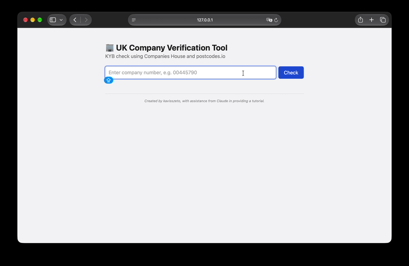
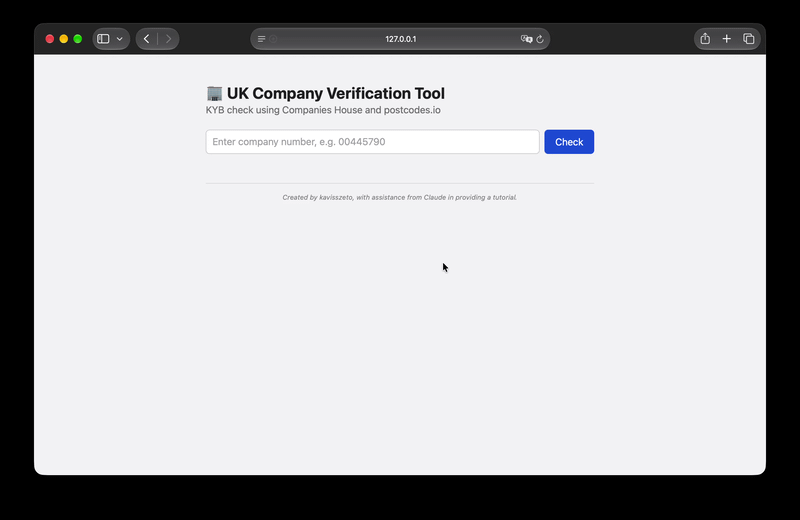
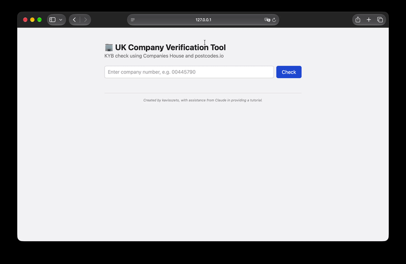
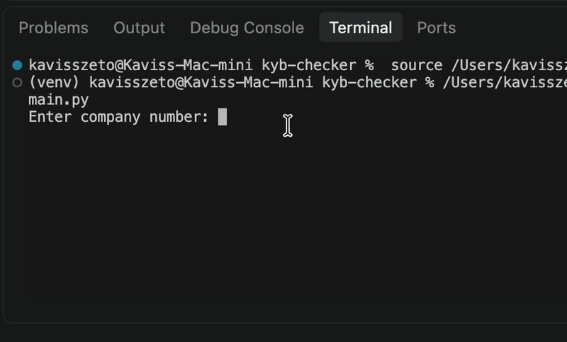

# Mini Company Verification Tool – UK KYB Checker

A Python web application that verifies UK-registered companies using public government data and flags basic risk signals. Users enter a Companies House company number, and the system retrieves the company's registration details, validates its registered office postcode, and highlights potential risks through a simple web interface.

## Project Overview

Know Your Business (KYB) is the process businesses and financial platforms use to verify that a company is real, active, and legitimate before working with it. It is a core part of identity verification and anti-fraud compliance.

This project was developed to explore how KYB checks work in practice and to gain hands-on experience with REST API integration. The tool combines two data sources: company records from the official Companies House API, and postcode validation from postcodes.io. It applies a set of rule-based checks to flag companies that may require further review.

During testing, several entity types, such as overseas companies, UK branches of overseas companies, and registered overseas entities, were initially flagged incorrectly. The risk rules were then refined to reduce these false positives, and information notes were added to explain each special case.

The application can be used through a Flask web interface or as a command-line tool, with both versions sharing the same verification logic.

## Key Features

### 1. Company Lookup

- Search for any UK-registered entity by its Companies House company number.
- Retrieve the company name, status, incorporation date, and registered office postcode.
- Support company numbers with prefixes, including:

| Prefix       | Entity Type                                    |
| ------------ | ---------------------------------------------- |
| Digits only  | Companies registered in England and Wales      |
| `SC`         | Companies registered in Scotland               |
| `NI`         | Companies registered in Northern Ireland       |
| `FC`         | Overseas companies registered in the UK        |
| `BR`         | UK establishments (branches) of overseas companies |
| `OE`         | Registered overseas entities that own UK property |

- Display a clear message when a company number cannot be found.

### 2. Input Validation

- Remove spaces and convert input to uppercase (e.g. `sc 123456` → `SC123456`).
- Add leading zeros to numeric company numbers (e.g. `445790` → `00445790`).
- Accept only inputs of exactly 8 letters or digits, and reject anything else before an API request is made.
- Prevent unexpected input, such as `00445790/officers`, from being inserted into the API request URL.

### 3. Address Validation

- Extract the registered office postcode from the company record.
- Validate UK postcodes using postcodes.io.
- Skip the UK postcode check for entities registered outside the UK, as their addresses use foreign postal formats (e.g. a US ZIP code).

### 4. Rule-Based Risk Flagging

The system applies three risk rules to each company:

| Rule              | Condition                                        | Reason                                                                     |
| ----------------- | ------------------------------------------------ | -------------------------------------------------------------------------- |
| Company status    | Status is not `active`, `open`, or `registered`  | Dissolved, liquidated, or closed entities should not be trading.           |
| Company age       | Incorporated less than 6 months ago              | Newly registered companies have limited history and carry higher risk.     |
| Registered office | UK postcode is missing or invalid                | An unverifiable address may indicate inaccurate or fraudulent information. |

Valid statuses and non-UK entity types are stored in configurable lists (`VALID_STATUSES` and `NON_UK_TYPES`), so new cases can be supported without rewriting the rules.

### 5. Information Notes for Special Entity Types

Instead of being flagged as risks, the following entity types are shown with a blue information note:

| Entity Type                 | Note                                                                                  |
| --------------------------- | ------------------------------------------------------------------------------------- |
| Overseas company            | Registered outside the UK, so the UK postcode check is skipped.                       |
| UK establishment            | Status "Open" means the branch is currently trading.                                  |
| Registered overseas entity  | A non-UK entity that owns UK property and has declared its beneficial owners.         |

### 6. Web Interface

- Enter a company number and view the results on a single page.
- Display company details in a summary card.
- List each risk flag individually with a warning message.
- Change the page background according to the result: light green when no risks are found, and light yellow when risks are found.

### 7. Security and Error Handling

- Store the API key in a `.env` file, which is excluded from version control through `.gitignore`.
- Validate user input before sending any API request.
- Set request timeouts to prevent the application from hanging if an API does not respond.
- Handle API errors without crashing the web interface.

## Technologies Used

- **Programming Language:** Python
- **Web Framework:** Flask
- **Templating:** Jinja2
- **Frontend:** HTML, CSS
- **HTTP Client:** requests
- **APIs:** Companies House Public Data API, postcodes.io
- **Authentication:** HTTP Basic Authentication (API key)
- **Configuration:** python-dotenv (environment variables)
- **Input Validation:** Regular expressions (`re`)
- **IDE:** Visual Studio Code

## Application Structure

| File                   | Description                                                                                        |
| ---------------------- | -------------------------------------------------------------------------------------------------- |
| `main.py`              | Handles input validation, API requests, and risk-check logic. Can also be run as a command-line tool. |
| `mini_app.py`          | Flask web application that provides the user interface.                                            |
| `templates/index.html` | HTML template for the web page, including CSS styling.                                             |
| `test_connection.py`   | Quick test to confirm that both APIs can be reached.                                               |
| `requirements.txt`     | List of Python packages required by the project.                                                   |

The project separates the verification logic (`main.py`) from the user interface (`mini_app.py` and `templates/index.html`). This allows the web version and the command-line version to reuse the same functions without duplicating code.

## Screenshots

Screenshots below demonstrate the main functions and interface of the application.

### Company with No Risks

<p align="center">
  
</p>

An active, long-established company with a valid registered office postcode. No risk flags are raised, and the page background turns light green.

### Company with Risk Flags

<p align="center">
  
</p>

A company in liquidation is flagged as a risk. Each triggered rule is listed with a warning message, and the page background turns light yellow.

### Overseas Entity

<p align="center">
  
</p>

A non-UK entity is shown with a blue information note. The UK postcode check is skipped, so the entity is not incorrectly flagged as a risk.

### Invalid Input and Company Not Found

<p align="center">
  
</p>

Input that does not match the company number format is rejected before any API request is made.

<p align="center">
  
</p>

When a valid company number does not exist in the Companies House register, an error message is displayed.

### Command-Line Version

<p align="center">
  
</p>

The same verification logic can be run directly in the terminal.

## How to Run

### Prerequisites

- Python 3.10 or later
- A free Companies House API key
- Internet connection

### Setup Instructions

**1. Download or clone the repository**

Download the project files or clone this repository to your local machine.

**2. Create and activate a virtual environment**

```bash
python3 -m venv venv
source venv/bin/activate
```

On Windows, use `venv\Scripts\activate` instead.

**3. Install the required packages**

```bash
pip install -r requirements.txt
```

**4. Get a Companies House API key**

- Register an account on the Companies House Developer Hub.
- Create a new application and select the **Live** environment.
- Create a **REST** API key.

**5. Create a `.env` file**

Create a file named `.env` in the project folder and add your API key:

```
COMPANIES_HOUSE_API_KEY=your_key_here
```

**6. Run the application**

Web interface:

```bash
python3 mini_app.py
```

Then open `http://127.0.0.1:5001` in your browser.

Command-line version:

```bash
python3 main.py
```

### Example Company Numbers for Testing

| Company Number | Expected Result                                  |
| -------------- | ------------------------------------------------ |
| `00445790`     | Active UK company with no risks                  |
| `03782379`     | Company in liquidation, flagged as a risk        |
| `FC035527`     | Overseas company with an information note        |
| `BR005889`     | UK establishment with an information note        |
| `OE031208`     | Registered overseas entity with an information note |
| `99999999`     | Company not found                                |

### Important Notes

- Never upload your `.env` file or share your API key publicly.
- The Companies House API allows up to 600 requests every five minutes.
- Port `5001` is used instead of Flask's default port `5000`, because macOS uses port `5000` for AirPlay Receiver.
- The risk rules are simplified for demonstration purposes and do not represent a complete KYB process.

## Possible Improvements

- Flag companies with a proposal to strike off (`company_status_detail`).
- Flag overdue accounts and confirmation statements.
- Flag companies with insolvency history.
- Flag undeliverable or disputed registered office addresses.
- Check company officers and persons with significant control (PSC).
- Batch-check multiple companies from a CSV file.
- Replace simple flags with a weighted risk score.

## What I Learned

Through this project, I gained practical experience in:

- Integrating external REST APIs and handling JSON responses.
- Authenticating API requests using HTTP Basic Authentication.
- Handling HTTP status codes, such as `200`, `401`, and `404`.
- Managing API keys securely using environment variables and `.gitignore`.
- Validating user input with regular expressions before using it in API requests.
- Designing rule-based risk checks based on real business verification concepts.
- Testing with different entity types to identify and reduce false positives.
- Refactoring conditions into configurable lists to make the rules easier to maintain.
- Cross-checking data from multiple sources to validate company information.
- Building a web application using Flask and Jinja2 templates.
- Applying conditional styling to present results clearly to users.
- Separating business logic from the user interface to make code reusable.

## Project Information

- **Project Type:** Personal Project
- **Purpose:** Exploring Know Your Business (KYB) verification and REST API integration
- **Completion Date:** November 2026

---

*This project was created by kavisszeto, with assistance from Claude in providing a tutorial (API integration and business verification concepts).*
